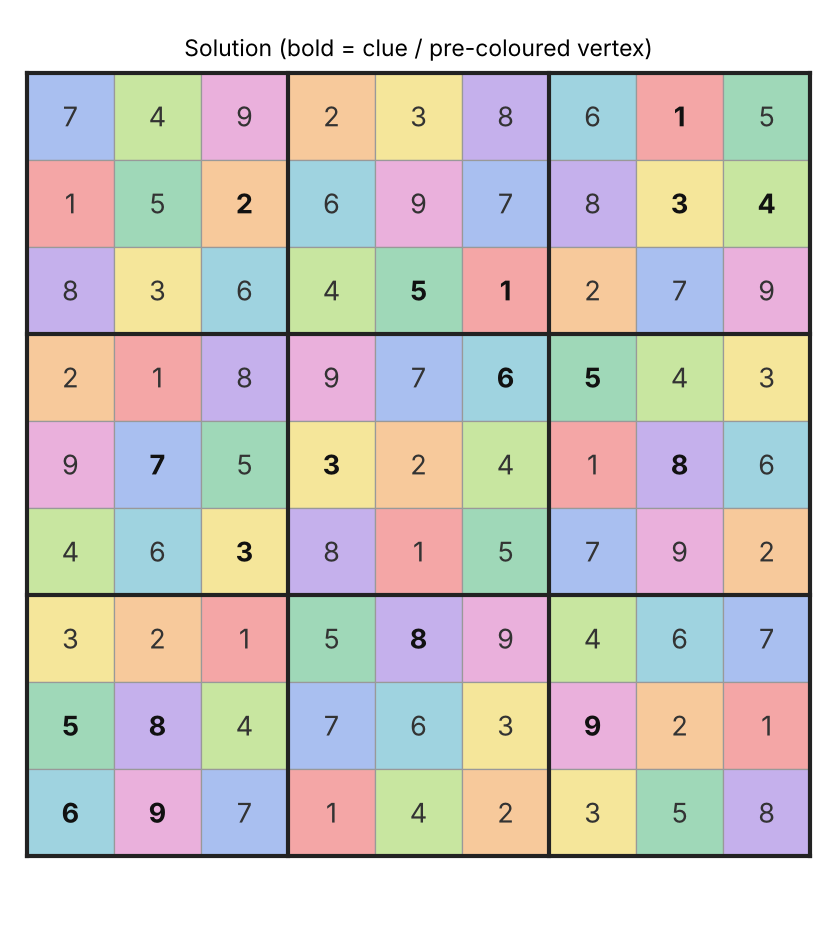
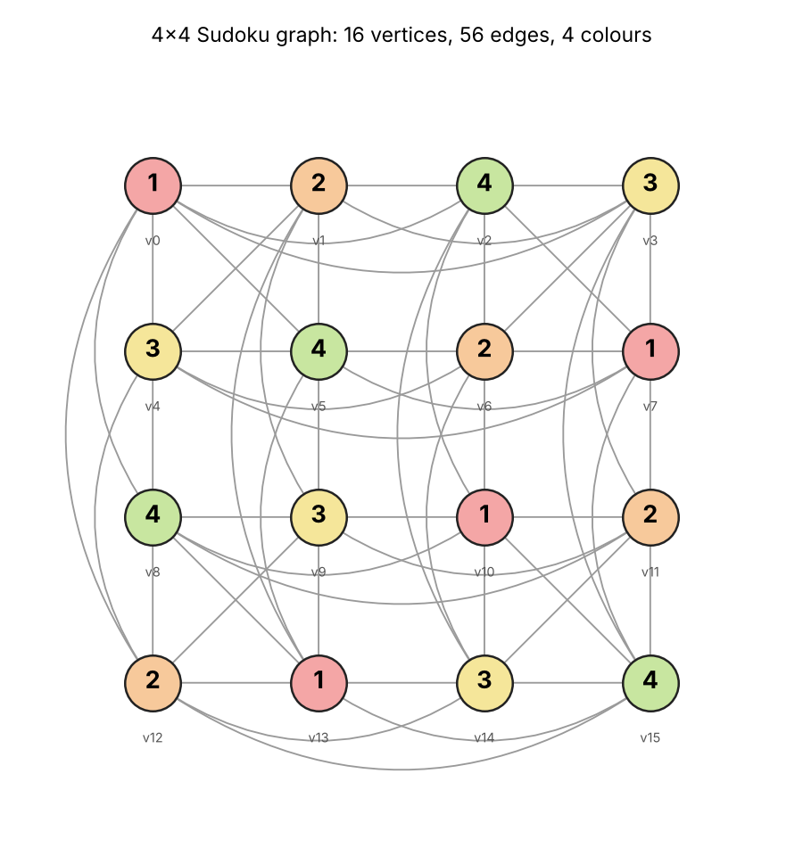
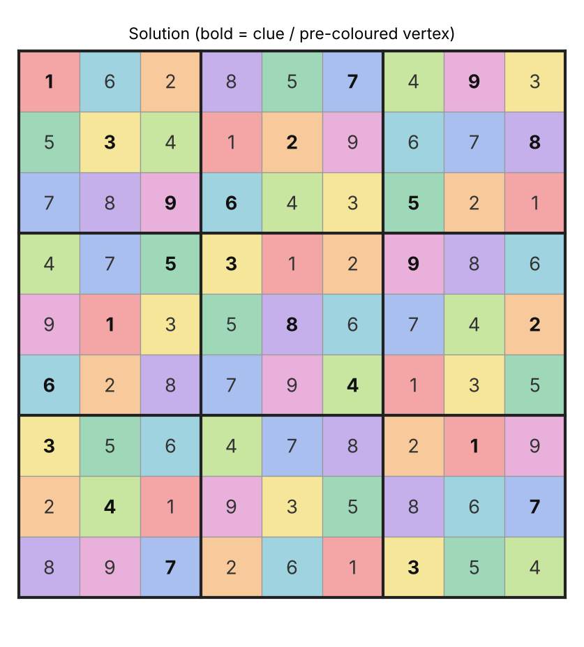
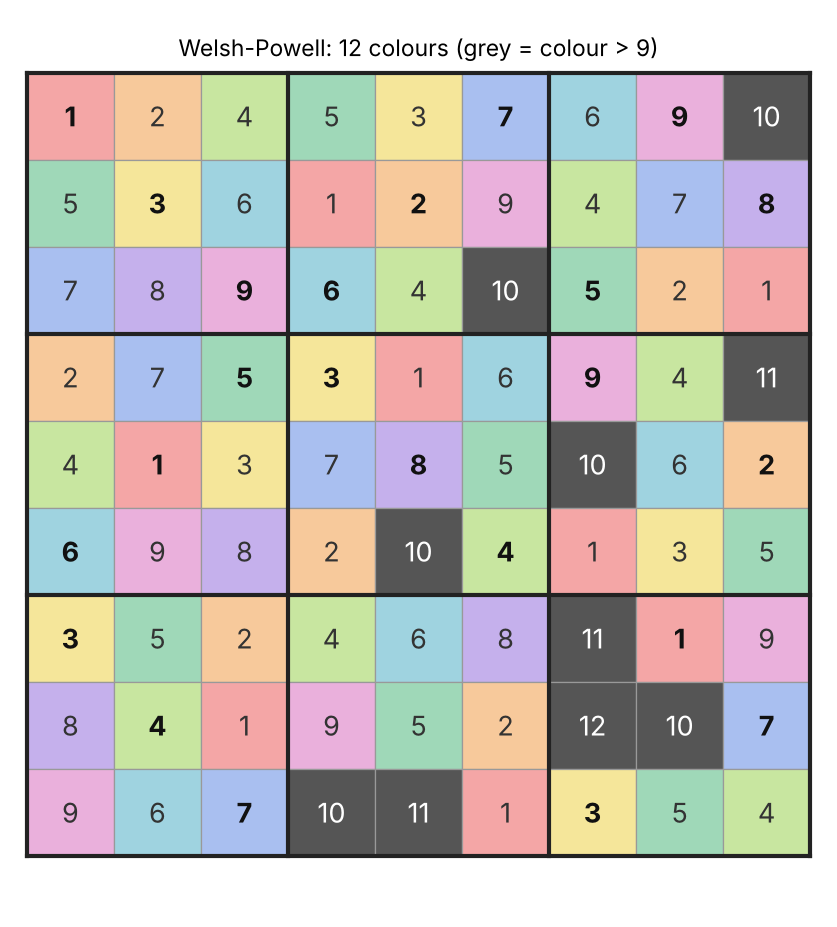

Rida BINDECH - 5999261011

# Sudoku Solver using Graph Coloring

Graph Theory project, **W11 Matching & Coloring**, coloring part: *"Implement a Sudoku solver using coloring"*.

A Sudoku is modelled as a graph, and solving it means finding a **proper vertex colouring with 9 colours** that extends the clues. The project implements and compares:

| Algorithm | Source | Solves Sudoku? |
|---|---|---|
| **Backtracking** (m-colouring) | lecture | ✅ always, but explores many nodes |
| **Backtracking + DSATUR/MRV + forward checking** | improvement | ✅ always, much faster |
| **Welsh-Powell** (greedy) | lecture | ❌ gives a proper colouring but with 12–14 colours instead of 9 |

Features: any size `n × n` with `n` a perfect square (4×4, 9×9, 16×16…), detection of invalid and unsolvable puzzles, uniqueness check (solution counting), automatic verification of every answer, PNG rendering of the coloured grid and of the graph, 35 unit tests.



---

## 1. Modelling: Sudoku → graph

| Sudoku | Graph |
|---|---|
| cell (row r, col c) | vertex `v = r·n + c` |
| two cells in the same row, column or box | edge between the two vertices |
| digit 1..9 | colour 1..9 |
| given clue | pre-coloured vertex (never changed) |
| rule "no repeated digit in a row/column/box" | proper colouring: adjacent vertices have different colours |
| solved grid | proper **9-colouring** extending the pre-colouring |

**Size of the graph.** With `n = b²` (box size `b`), each vertex is adjacent to `n-1` cells of its row, `n-1` of its column, and `(b-1)²` cells of its box that are not already counted. The graph is therefore **regular**:

```
deg(v) = 2(n-1) + (b-1)²           |V| = n²          |E| = n² · deg / 2
4×4  :  deg = 7     |V| = 16    |E| = 56
9×9  :  deg = 20    |V| = 81    |E| = 810
16×16:  deg = 39    |V| = 256   |E| = 4992
```

**Chromatic number.** Each row is a clique of `n` vertices (all mutually adjacent), so χ(G) ≥ n. A solved Sudoku is an n-colouring, so χ(G) = n (9 for a normal Sudoku). The difficulty is not to *find* the chromatic number but to find an n-colouring that **respects the clues**: this pre-colouring extension problem is NP-complete in general (Sudoku of size n²×n² is NP-complete, Yato & Seta, 2003).

The 4×4 graph, drawn with its 4-colouring (`sample_output/images/mini_4x4_graph.png`):



---

## 2. Algorithms

### 2.1 Basic backtracking (lecture algorithm)
`sudoku_coloring/coloring.py → backtracking_basic`

Same structure as the `colorGraph(graph, colorOptions, currentVertex, verticesColor)` pseudocode from the lecture: uncoloured vertices are visited in a fixed order (reading order), for each one the colours `1..9` are tried, and the colour is reset when the recursive call fails (**backtrack**).

One deliberate difference: the lecture pseudocode calls `isSafeToColor` only once **all** vertices are coloured. Applied to the slide Sudoku (63 empty cells), that would mean up to 9⁶³ ≈ 10⁶⁰ complete colourings to test. Here `is_safe(v, c)` is checked **when the colour is assigned** (only against `v`'s neighbours, O(deg)), so a bad branch is cut as soon as it appears. This is the usual m-colouring backtracking.

### 2.2 Backtracking + DSATUR/MRV + forward checking
`backtracking_dsatur`

Two improvements on top of 2.1:

1. **DSATUR / MRV vertex choice.** Instead of a fixed order, always colour the vertex with the **fewest legal colours left** (= highest *saturation*: number of different colours among its neighbours). A cell with only one possible digit is filled immediately; a cell with zero possible digits is detected at once.
2. **Forward checking.** Each uncoloured vertex keeps its *domain* (legal colours). When colour `c` is given to `v`, `c` is removed from the domains of `v`'s uncoloured neighbours. If a domain becomes empty, the branch is abandoned **before** going deeper. Domains are restored on backtrack.

**Tie-breaking.** When several vertices have the same number of legal colours, two rules are available:
- `index` (default): the first one in reading order;
- `degree` (textbook DSATUR / degree heuristic): the one with the most uncoloured neighbours.

The benchmark (section 5) shows that the textbook `degree` rule is **worse** on Sudoku. This is a nice result, so both are kept for comparison (`--algo dsatur-degree`).

### 2.3 Welsh-Powell (lecture algorithm)
`welsh_powell`

1. Sort the vertices by decreasing degree.
2. Give colour 1 to the first vertex, then go down the list and give colour 1 to every vertex not adjacent to a vertex already coloured 1.
3. Repeat with colours 2, 3… until every vertex is coloured.

Clues are respected (they start in their colour class). The result is always a **proper** colouring, but Welsh-Powell is a **greedy heuristic**: it never revises a choice, so it does not guarantee χ(G) colours. On Sudoku it is also handicapped by the graph structure: **all vertices have degree 20**, so sorting by degree carries no information, and the algorithm reduces to plain first-fit in reading order. Result: 12–14 colours on 9×9 grids, i.e. some cells receive a "digit" 10, 11, 12… that does not exist. Even on the **empty** 9×9 grid it uses **14 colours** while χ(G) = 9.

This is the expected conclusion: greedy colouring gives an upper bound on χ(G) quickly, but solving a Sudoku needs an exact search (backtracking).

### 2.4 Validation and uniqueness
- **Clue check** (`find_conflicts`): if two adjacent vertices are pre-coloured with the same colour, the puzzle is rejected before any search and the conflicting cells are printed.
- **Verification** (`is_valid_coloring`): every answer is checked again (complete, colours in 1..n, no edge with equal colours, clues unchanged).
- **Counting** (`count_solutions`): the DSATUR search continues after the first solution to count solutions (up to 10,000). This tells whether a puzzle is well-posed (exactly 1 solution).

---

## 3. Project structure

```
sudoku-graph-coloring/
├── main.py                    # command-line interface
├── generate_samples.py        # regenerates everything in sample_output/
├── sudoku_coloring/
│   ├── graph.py               # Graph + SudokuGraph (vertices, edges, degrees)
│   ├── coloring.py            # backtracking, DSATUR + forward checking, Welsh-Powell, counting, checks
│   ├── sudoku_io.py           # parsing / printing grids
│   └── visualize.py           # optional PNG rendering (matplotlib)
├── puzzles/
│   ├── slide_example.txt      # the Sudoku from the lecture slide
│   ├── easy.txt
│   ├── hard_ai_escargot.txt   # "AI Escargot" (A. Inkala), known as a very hard puzzle
│   ├── mini_4x4.txt
│   ├── large_16x16.txt
│   ├── invalid_clues.txt      # two equal clues in one row
│   └── unsolvable.txt         # consistent clues, but no solution
├── sample_output/             # console outputs, benchmark.md, images/
├── tests/test_sudoku_coloring.py
├── requirements.txt
└── pyproject.toml             # pytest configuration
```

---

## 4. Installation and usage

Requires **Python 3.10+**. The solver uses only the standard library; `matplotlib` is needed only for images, `pytest` only for tests.

```bash
git clone <repo-url>
cd sudoku-graph-coloring
pip install -r requirements.txt      # optional: matplotlib + pytest
```

```bash
# solve with the default algorithm (DSATUR + forward checking)
python main.py puzzles/easy.txt

# run and compare every algorithm, and check uniqueness
python main.py puzzles/slide_example.txt --algo all --count-solutions

# save the solved grid as an image
python main.py puzzles/hard_ai_escargot.txt --png solution.png

# 4x4: also draw the graph with its colouring
python main.py puzzles/mini_4x4.txt --png grid.png --graph-png graph.png

# regenerate sample_output/ and the benchmark (about 30 s, mostly the basic solver giving up on the 16x16)
python generate_samples.py

# tests
python -m pytest
```

Options:

| Option | Meaning |
|---|---|
| `--algo {basic,dsatur,dsatur-degree,welsh-powell,all}` | algorithm (default `dsatur`) |
| `--max-nodes N` | search budget for backtracking (default 1,000,000), the search stops with "Aborted" beyond it |
| `--count-solutions` | count solutions (up to 10,000) |
| `--png FILE` | save the solved grid as an image (also `FILE_welsh_powell.png` with `--algo all`) |
| `--graph-png FILE` | draw the graph with its colouring (4×4 only, larger graphs are unreadable) |

Exit code: `0` solved, `1` no solution / aborted, `2` invalid clues, `3` bad file.

### Input format

One row per line; `#` lines are comments. Up to 9×9: one character per cell, `.` or `0` for an empty cell. Any size (needed for 16×16): integers separated by spaces, `0` for empty. The size is detected automatically.

```
# puzzles/mini_4x4.txt
1...
..2.
.3..
...4
```

---

## 5. Results

### Sample output (`sample_output/easy.txt`, shortened)

```
=== Sudoku solver using graph colouring ===
Puzzle file : puzzles/easy.txt
Sudoku graph 9x9: |V| = 81, |E| = 810, every vertex has degree 20, target: proper colouring with 9 colours (chi(G) = 9)
Clues (pre-coloured vertices): 30 / 81

Input grid:
+-------+-------+-------+
| 5 3 . | . 7 . | . . . |
| 6 . . | 1 9 5 | . . . |
| . 9 8 | . . . | . 6 . |
+-------+-------+-------+
| 8 . . | . 6 . | . . 3 |
| 4 . . | 8 . 3 | . . 1 |
| 7 . . | . 2 . | . . 6 |
+-------+-------+-------+
| . 6 . | . . . | 2 8 . |
| . . . | 4 1 9 | . . 5 |
| . . . | . 8 . | . 7 9 |
+-------+-------+-------+

Clue check  : OK (no edge joins two clues of the same colour)
Solutions   : 1 -> well-posed (unique)

--- Backtracking (basic, lecture) ---
Result      : Solved
Nodes       : 4208  (colour assignments tried)
Backtracks  : 4157
...
--- Backtracking + DSATUR/MRV + forward checking ---
Result      : Solved
Nodes       : 51  (colour assignments tried)
Backtracks  : 0
Time        : 0.2 ms
Verification: proper 9-colouring = True, clues kept = True -> VALID SUDOKU
+-------+-------+-------+
| 5 3 4 | 6 7 8 | 9 1 2 |
| 6 7 2 | 1 9 5 | 3 4 8 |
| 1 9 8 | 3 4 2 | 5 6 7 |
+-------+-------+-------+
| 8 5 9 | 7 6 1 | 4 2 3 |
| 4 2 6 | 8 5 3 | 7 9 1 |
| 7 1 3 | 9 2 4 | 8 5 6 |
+-------+-------+-------+
| 9 6 1 | 5 3 7 | 2 8 4 |
| 2 8 7 | 4 1 9 | 6 3 5 |
| 3 4 5 | 2 8 6 | 1 7 9 |
+-------+-------+-------+

--- Welsh-Powell (greedy) ---
Result      : Proper colouring with 12 colours -> 13 cell(s) got a colour > 9: not a valid Sudoku
   5    3    1    2    7    4    8    9 [10]
   6    2    4    1    9    5    3 [11]    7
[10]    9    8    3 [11] [12]    1    6    2
...
```

Full outputs for every puzzle are in [`sample_output/`](sample_output/), including the invalid and unsolvable cases.

| Backtracking (DSATUR) | Welsh-Powell on the same puzzle |
|---|---|
|  |  |

*Bold digits are the clues (pre-coloured vertices). Grey cells received a colour > 9 from Welsh-Powell.*

### Benchmark (`sample_output/benchmark.md`)

Nodes = number of colour assignments tried (deterministic). Times measured on a Linux machine with Python 3.13 and will differ on another computer.

| Puzzle | Size | Clues | Solutions | Basic backtracking (lecture) | DSATUR/MRV + FC | DSATUR/MRV + FC, degree tie-break | Welsh-Powell |
|---|---|---|---|---|---|---|---|
| `easy.txt` | 9x9 | 30 | 1 | 4,208 nodes, 16.7 ms | 51 nodes, 0.2 ms | 51 nodes, 0.2 ms | 12 colours (13 cells > 9) |
| `hard_ai_escargot.txt` | 9x9 | 23 | 1 | 8,969 nodes, 33.9 ms | 217 nodes, 1.0 ms | 1,070 nodes, 6.2 ms | 12 colours (10 cells > 9) |
| `invalid_clues.txt` | 9x9 | 2 | invalid clues | - | - | - | - |
| `large_16x16.txt` | 16x16 | 114 | 1 | aborted (> 1,000,000 nodes, 9.6 s) | 2,395 nodes, 20.8 ms | 22,107 nodes, 267.8 ms | 23 colours (36 cells > 16) |
| `mini_4x4.txt` | 4x4 | 4 | 1 | 15 nodes, 0.0 ms | 12 nodes, 0.0 ms | 12 nodes, 0.0 ms | 7 colours (4 cells > 4) |
| `slide_example.txt` | 9x9 | 18 | 1699 | 122,428 nodes, 470.4 ms | 1,601 nodes, 7.9 ms | 15,444 nodes, 87.3 ms | 13 colours (12 cells > 9) |
| `unsolvable.txt` | 9x9 | 9 | 0 | no solution (0 nodes) | no solution (0 nodes) | no solution (0 nodes) | 14 colours (18 cells > 9) |

### Analysis

1. **DSATUR/MRV + forward checking beats the lecture backtracking by 1–2 orders of magnitude**: 51 vs 4,208 nodes on the easy grid, 217 vs 8,969 on AI Escargot, 1,601 vs 122,428 on the slide example. On the 16×16 the gap becomes decisive: the basic version gives up after 1,000,000 nodes (≈ 10 s) while DSATUR solves it in 2,395 nodes (≈ 20 ms). Choosing the most constrained cell first means most choices are forced (domain of size 1), and forward checking detects dead ends one level earlier.
2. **The textbook degree tie-break is counter-productive on Sudoku** (1,070 vs 217 nodes on AI Escargot, 15,444 vs 1,601 on the slide example, 22,107 vs 2,395 on the 16×16). The graph is regular, so "most uncoloured neighbours" just means "the cell in the emptiest area", where a guess is the least informed. Heuristics that work well on general graphs do not automatically transfer to a very regular structure.
3. **Welsh-Powell never solves a Sudoku.** It always returns a proper colouring in about a millisecond, but with 12–14 colours on 9×9 grids, 23 on the 16×16 and even 7 on the 4×4 (instead of 4). Greedy colouring gives an upper bound on χ(G), not a guarantee.
4. **Invalid and unsolvable inputs are detected without search** (0 nodes): conflicting clues are rejected by the clue check, and in `unsolvable.txt` the cell (row 1, col 9) has an empty domain from the start (row 1 already uses 1–8, column 9 already contains 9).

### Note on the lecture's example

The Sudoku shown on the slide (*Application of Coloring*, 18 clues) **is not a well-posed puzzle: it has 1,699 different solutions** (`--count-solutions`). The grid shown on the slide is one of them; our test suite checks that it is a valid 9-colouring that respects the clues (`test_slide_solution_is_a_valid_colouring_of_the_slide_puzzle`). Our solvers return another, equally valid, solution. This is why, in a well-posed Sudoku (unique solution), around 17 clues is the theoretical minimum, and why the uniqueness check was added.

---

## 6. Complexity

With `V = n²` vertices, degree `d = 2(n-1)+(b-1)²` (so `d = O(n)`), `m` empty cells:

| Part | Cost |
|---|---|
| Graph construction | O(V · n) = O(n³) |
| `is_safe(v, c)` | O(d) |
| Clue check / final verification | O(\|E\|) = O(n² · d) |
| Basic backtracking | worst case O(n^m) nodes, O(n · d) work per node |
| DSATUR + FC | worst case still exponential (the problem is NP-complete); O(m + d) per node (linear scan to pick the vertex, update of the neighbours' domains); in practice far fewer nodes |
| Welsh-Powell | O(V log V + C · V · d) where C is the number of colours used |

Memory: O(|E|) for the adjacency sets, O(V · n) for the domains, O(m) recursion depth.

---

## 7. Tests

`python -m pytest` runs 35 tests: graph sizes and degrees (4×4, 9×9, 16×16), adjacency rules, parsing of both formats and malformed files, every solver on every solvable puzzle (validity and clues kept), same answer from every solver on a unique puzzle, DSATUR using fewer nodes than basic, node budget, the 1,699 solutions of the slide example, invalid and unsolvable puzzles, and Welsh-Powell giving a proper colouring with more than 9 colours.

---

## 8. Limitations and possible extensions

- Pure Python: a 16×16 is solved in a fraction of a second with DSATUR, but the basic backtracking exceeds the 1,000,000-node budget. Bigger grids (25×25) would need stronger propagation.
- Possible extensions: *hidden singles* (a digit that can only go in one cell of a row/col/box), arc consistency (AC-3), bitsets for the domains, or a SAT / exact-cover (Dancing Links) formulation.
- The vertex choice is a linear scan over the uncoloured vertices. A priority queue would reduce it to O(log m) on large grids.

## References

- Course slides, *W11 Matching and Coloring*: Coloring, chromatic number, Backtracking, Welsh-Powell, Sudoku as vertex coloring.
- D. Brélaz, *New methods to color the vertices of a graph*, Communications of the ACM, 1979 (DSATUR).
- D. J. A. Welsh, M. B. Powell, *An upper bound for the chromatic number of a graph and its application to timetabling problems*, The Computer Journal, 1967.
- T. Yato, T. Seta, *Complexity and completeness of finding another solution and its application to puzzles*, 2003 (NP-completeness of Sudoku).
- G. McGuire, B. Tugemann, G. Civario, *There is no 16-clue Sudoku*, 2012.
